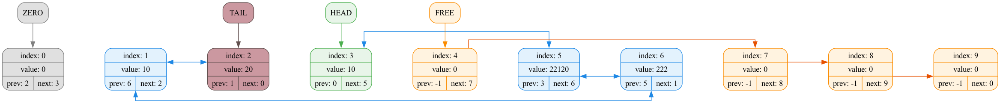
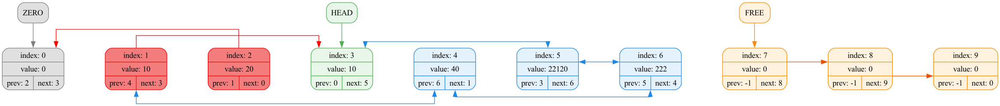

# Двусвязный список на массиве с красивым графическим дампом

> Реализация одной из самых популярных структур данных - связного (двусвязного) списка - на массиве с кольцевым фиктивным элементом. Главная ценность данного кейса для моей бошки - знакомство и обучение графическому дебагу (дебагу с визуализацией)

---

## Feature List
- реализована отдельная функция верификации узла (проверки на корректность его содержимого)
- максимально жирная яркая и кричащая подсветка ошибок, они сразу же бросаются в глаза, что в разы упростит дебаг, особенно часа в 3 ночи
- реализован кольцевой список с фиктивным элементом, что очень сильно упрощает жизнь и код

---

## О проекте
Реализация базовой структуры данных на языке СИ -  двусвязного списка. Однако его стандартная реализация делается через указатели и динамическую память, это же решение иного плана. Мы храним весь список в виде массива (в данной реализации динамического - при нехватке места он расширяется) структур, состоящих из полей value, next и prev, 2 последних поля - индексы соответствующих следующего и предыдущего элементов. Список сделан кольцевым, с использованием фиктивного нулевого элемента. Также реализован односвязный список свободных элементов прямо внутри этого массива для того, чтобы обеспечить максимально быструю вставку новых элементов. В целом сложность различных операций со списком:
| Операция | Временная сложность |
| :--- | :---: |
| **Вставка в начало / конец** | **$O(1)$** |
| **Вставка после/перед заданным элементом** | **$O(1)$** |
| **Удаление из начала / конца** | **$O(1)$** |
| **Удаление заданного элемента** | **$O(1)$** |
| **Поиск элемента по значению** | **$O(n)$** |
| **Доступ по индексу списка (не массива)** | **$O(n)$** |

---

## Графические дампы
Так как список - структуры данных с довольно сложной иерархией элементов, дебагинг в текстовом виде может быть очень неудобным. Поэто были реализованы дампы в .html файл с генерацией диаграмм-схем состояния списка на текущий момент. Генерация сделана с помощью graphviz. Примеры сгенерированных графических дампов:

*Валидный список*

*Список с ошибкой (жестко испортили индекс связи)*

---

## Связь со мной
Я всегда рад отзывам, предложениям, общению и денюжке. Свяжитесь со мной, если хотите предложить мне один из этих пунктов: [мяу](https://t.me/mathusha2023)
